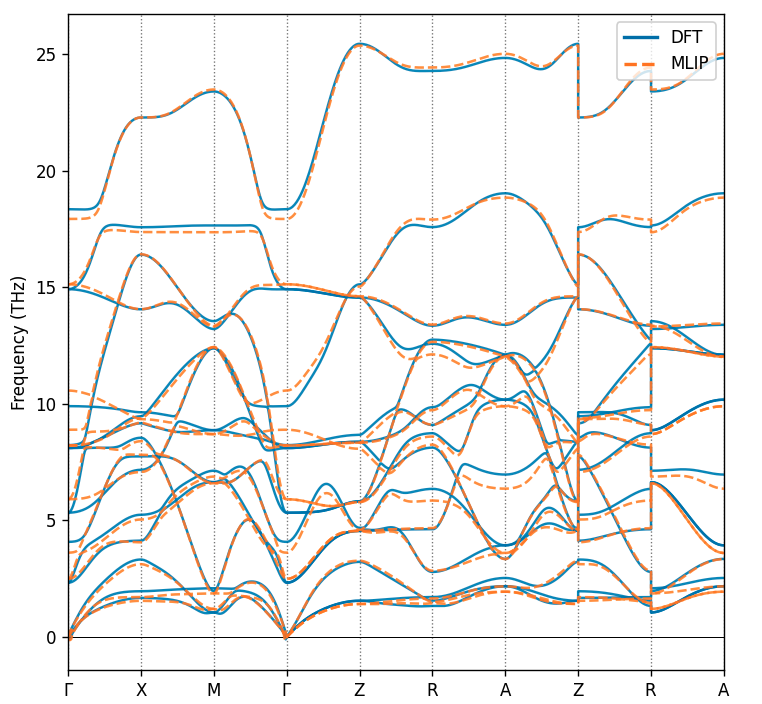
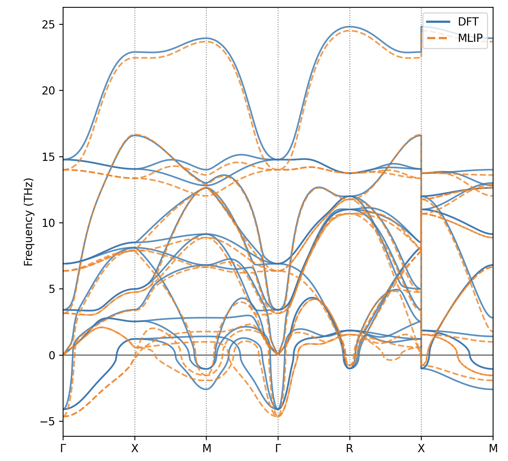

# PbTiO<sub>3</sub> MLIP model 

Here you'll find a MLIP model for PbTiO<sub>3</sub> trained with MACE

## Content

`model` directory contains the model trained with MACE. Note: the model was trained using GPU acceleration `cuda` 
and will not run on `cpu` or Apple Silicon `mps`. 

`example` contains example scripts of using the MLIP model for geometry optimisation and phonon calculations. The MACE 
will work with any ASE interface via: 

```commandline
from mace.calculators import MACECalculator

# Initialize calculator
mace = MACECalculator(model_paths='../../model/MACE_C09x-PBEc_QE.model', device='cuda')
atoms = read('PTO_tet.cif', '0')
atoms.calc = mace

```


## Benchmarking 

### Lattice Parameters 

Below is how the model performs at geometry optimisation for the tetragonal and cubic phase against reference DFT data 
from Quantum Espresso. The model was trained using our DFT functional C09x-PBEc (
https://doi.org/10.48550/arXiv.2608.04806).  

| Phase | Lattice Parameter / Å | DFT  | MLIP Model |   Exp.   |
| :--- |:----------------------|:----:|:----------:|:--------:|
| Cubic | $a$                   | 3.90 |    3.91    | 3.93 [1] |
| Tetragonal | $a$                   | 3.87 |    3.87    | 3.90 [2] |
| | $c$                   | 4.07 |    4.08    | 4.15 [2] |

**References:**
* [1] [https://doi.org/10.1107/S0021889879011754](https://doi.org/10.1107/S0021889879011754)
* [2] [https://doi.org/10.1103/PhysRev.97.1179](https://doi.org/10.1103/PhysRev.97.1179)


### Phonon calculations 

The model performs well for phonon calculations. Below are band structures for the cubic and tetragonal phase
of PbTiO<sub>3</sub> with comparison between the MLIP model and DFT calculations performed with Quantum Espress
and Phonopy. 

#### Tetragonal: 


#### Cubic: 
